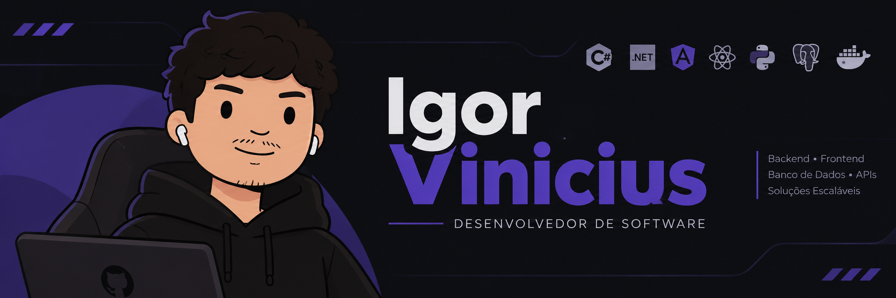

<div align="center">

<div align="center">
  
</div>

### Estudante de Engenharia de Software | Desenvolvedor Full Stack


[](https://www.linkedin.com/in/igor-vinicius-6bb571283/)
[](https://portfolioaraujo.vercel.app/)
[](mailto:iaraujopecedossantos@gmail.com)

---

</div>

##  Sobre Mim

Sou estudante de  **Desenvolvimento de Software Multiplataforma (DSM)**, focado no ecossistema **Backend, APIs RESTful e Aplicações Full Stack**.

-  **Foco Principal:** C#, .NET, TypeScript e Angular.
-  **Áreas de Interesse:** Arquitetura de Software, Modelagem de Bancos de Dados, Performance e Segurança em APIs.
-  **O que procuro:** Minha primeira oportunidade profissional em Desenvolvimento de Software para impactar negócios com código eficiente.

---

| Categoria | Tecnologias |
| :--- | :--- |
| **Backend** | `C#` `.NET` `ASP.NET Core` `Entity Framework` `Node.js` `Python` |
| **Frontend** | `TypeScript` `Angular` `React` `Tailwind CSS` `HTML5` `CSS3` |
| **Bancos de Dados** | `PostgreSQL` `MySQL` `SQL Server` `MongoDB` |
| **DevOps & Ferramentas** | `Docker` `Git` `GitHub` `Postman` `Vite` `Figma` |
| **Conceitos** | `REST APIs` `JWT` `Autenticação` `Arquitetura de Software` |

---

##  Atualmente Aprofundando

<div align="center">

```text
 C# & .NET                                  TypeScript & Angular
├── ASP.NET Core Web APIs                  ├── Componentes e Diretivas
├── Entity Framework Core (ORM)            ├── RxJS e Serviços
├── Autenticação & JWT                     ├── Consumo e Integração de APIs REST
└── Arquitetura Limpa / DDD                └── Arquitetura Limpa no Frontend
